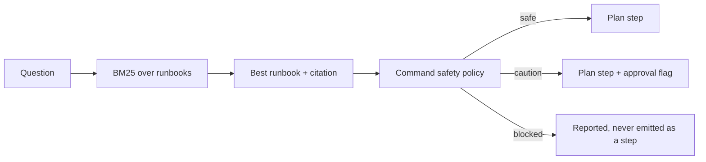

# RunbookIQ

**Ask an ops question. Get a cited runbook plan where every shell command is classified before you can run it.**

Most "agentic RAG for IT support" demos stop at retrieval. That is the easy half.
The part that hurts in production is the command a model tells an on-call engineer
to paste into a shell. RunbookIQ keeps commands behind an explicit, reviewable
policy: `safe`, `caution` (approval required) or `blocked` (never emitted).

[](https://github.com/abubakarsiddique360/RunbookIQ/actions/workflows/ci.yml)
[](pyproject.toml)
[](LICENSE)
[](pyproject.toml)

## Quick start

```bash
git clone https://github.com/abubakarsiddique360/RunbookIQ.git
cd RunbookIQ
python -m venv .venv
# Windows: .venv\Scripts\activate     macOS/Linux: source .venv/bin/activate
pip install -e ".[dev]"

runbookiq list
runbookiq plan "disk is full on the worker node"
runbookiq check "kubectl delete ns prod"     # exits 1: blocked
```

```
Runbook : Node disk pressure (disk-pressure)
Match   : score 12.41 via disk, pressure, node
Approval: required

1. [safe] Confirm which filesystem is full
   $ kubectl get nodes -o wide
   policy: read-only command (kubectl get)
2. [safe] Inspect usage on the affected node
   $ du -xh --max-depth=1 /var/log | sort -h | tail -n 20
   policy: read-only command (du )
...
5. [caution] Remove stale images from the runtime cache
   $ kubectl drain NODE_NAME --ignore-daemonsets --delete-emptydir-data
   policy: changes cluster state

Source: knowledge/disk-pressure.md
```

## How it works



1. **Retrieve** — Okapi BM25 over runbook text (title weighted twice, system and
   tags included). Unrelated questions return nothing rather than a wrong runbook.
2. **Pluck steps** — each `## Step` heading plus its fenced `bash` block becomes a
   step; prose around it becomes the note.
3. **Classify** — blocked rules are evaluated first, then caution rules, then the
   read-only prefix allowlist. Anything unrecognised is `caution`, never `safe`.
4. **Report** — steps keep their citation (`Source: knowledge/<file>.md`), and
   blocked commands appear in a clearly separated section.

## Command policy

```json
{
  "rules": [
    { "pattern": "rm\\s+-[a-z]*r[a-z]*f?\\s+(/|~|\\*)(\\s|$)", "verdict": "blocked", "reason": "recursive delete of a root or home path" },
    { "pattern": "kubectl\\s+(delete|drain|cordon)\\b", "verdict": "caution", "reason": "changes cluster state" }
  ],
  "safe_prefixes": ["kubectl get", "kubectl describe", "df ", "systemctl status"]
}
```

| Verdict | Meaning | Examples |
| --- | --- | --- |
| `blocked` | never emitted as an executable step | `rm -rf /`, `DROP TABLE`, `curl … \| sh`, `kubectl delete ns prod` |
| `caution` | requires human approval | `systemctl restart nginx`, `kubectl drain`, `journalctl --vacuum` |
| `safe` | read-only | `kubectl get pods`, `df -h`, `openssl x509 -in …` |

`check` exits `1` for a blocked command, so the same policy can gate a CI job, a
chatbot reply or a shell alias.

## Adding a runbook

Create `knowledge/<id>.md`:

```markdown
---
id: queue-backlog
title: Message queue backlog
system: kafka
summary: Find why consumer lag keeps growing.
tags: [queue, lag, consumer]
---

## Step 1 - Measure lag per partition

```bash
kafka-consumer-groups --describe --group GROUP_NAME
```
```

Then `runbookiq list` should show it and `runbookiq plan "consumer lag"` should
retrieve it. Steps without a `bash` block are ignored, so prose sections are safe.

## Project layout

```text
src/runbookiq/
├── kb.py        frontmatter + step parsing
├── search.py    BM25 retrieval
├── policy.py    command classification (blocked > caution > safe)
├── planner.py   cited plans with gating
└── cli.py       plan · search · list · check
knowledge/       4 runbooks: disk, TLS, crashloop, VPN
tests/           40 pytest cases
```

## Design notes

- **Deny by default.** An unrecognised command is `caution`, not `safe`. The
  allowlist is explicit and short.
- **Blocked steps are shown, not hidden.** Operators need to know a runbook
  suggested something dangerous — that is a documentation bug to fix.
- **No vector database.** Four to four hundred runbooks fit in memory; BM25 is
  deterministic and explains its matches.
- **Citations point at files.** `Source:` is a path a reviewer can open in a PR.

## Limitations

- The policy is regex-based: it catches patterns, not intent. Treat `safe` as
  "read-only by construction", never as "approved".
- Runbooks are trusted input; a malicious runbook can still describe dangerous
  prose steps that contain no command.
- No execution: RunbookIQ never runs anything. It only labels.

## License

[MIT](LICENSE) © 2026 **ABU BAKAR SIDDIQUE**
